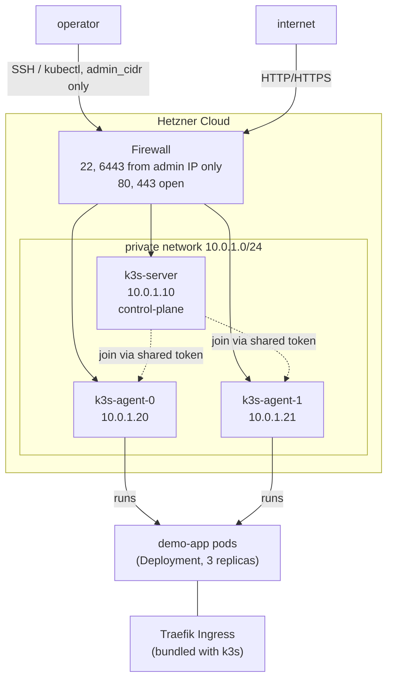

# terraform-k3s-cluster

Infrastructure-as-code for a small private Kubernetes cluster on Hetzner
Cloud: Terraform provisions the nodes and a private network, cloud-init
bootstraps [k3s](https://k3s.io) on them with zero manual SSH steps, and a
sample Go service ships on top with Kubernetes manifests (Deployment,
Service, Ingress, HPA) ready to apply.

## Architecture



- **1 control-plane node + N agent nodes** (`agent_count`, default 2),
  each a Hetzner `cx22` by default — swap `server_type`/`agent_server_type`
  for bigger instances.
- **Private network** for node-to-node traffic; only the operator's own
  IP (`admin_cidr`) can reach SSH or the k3s API. HTTP/HTTPS are open, same
  as any public-facing cluster.
- **No provisioners, no post-create SSH step.** The k3s join token is
  generated by Terraform (`random_password`) and baked into every node's
  `cloud-init` `user_data` at create time — `terraform apply` alone gets
  you a joined cluster.
- **Traefik** ships inside k3s by default, so the sample `Ingress` in
  `k8s/` needs no extra controller install.

## Repo layout

```
versions.tf, variables.tf, main.tf, outputs.tf   root module — wires everything together
terraform.tfvars.example                         copy to terraform.tfvars and fill in
modules/k3s-cluster/                              the reusable module: network, firewall, servers
modules/k3s-cluster/cloud-init/                   cloud-init templates that install k3s
k8s/                                               Deployment, Service, Ingress, HPA for the sample app
app/                                               the sample Go service deployed onto the cluster
.github/workflows/terraform.yml                    fmt + validate on every PR touching *.tf
.github/workflows/app-ci.yml                        build/vet/test/docker-build the app + lint k8s manifests
```

## Quick start

```bash
# 1. Infra
cp terraform.tfvars.example terraform.tfvars
# edit terraform.tfvars: admin_cidr, ssh_public_key_path, etc.
export TF_VAR_hcloud_token="your-hetzner-api-token"

terraform init
terraform plan
terraform apply

# 2. Kubeconfig
terraform output -raw kubeconfig_fetch_command | bash
export KUBECONFIG=./kubeconfig.yaml
kubectl get nodes

# 3. App
kubectl apply -f k8s/
kubectl -n demo-app get pods -w
curl http://<any-node-ip>/      # -H "Host: demo.example.com" once Ingress DNS is set up
```

Tear down with `terraform destroy` — nothing here is designed to run
unattended or unmonitored.

## Known gotchas (the kind you only learn by hitting them)

- **`private_network_iface` isn't guaranteed.** k3s needs `--flannel-iface`
  pointed at the NIC on the private network, and its name
  (`enp7s0` here) varies by Hetzner server type and image. After first
  boot, `ssh` in and check `ip a` before assuming the default is right —
  if it's wrong, flannel binds to the public NIC and inter-node pod
  traffic breaks silently.
- **CI can `fmt`/`validate` without any secrets**, but the `plan` job
  needs `HCLOUD_TOKEN` and `ADMIN_CIDR` repo secrets *and* a reachable
  SSH public key to resolve `file(var.ssh_public_key_path)` — it's wired
  up but won't go green until those are configured.
- **State is local by default.** Fine for a demo; for anything real, add
  an `hcloud`-independent remote backend (S3-compatible, e.g. Hetzner
  Object Storage) before a second person touches this.

## What this demonstrates

Terraform module structure and variables, provisioning real cloud
infrastructure (not just `docker-compose`), cloud-init-driven bootstrap
without configuration-management tooling, a private network + firewall
model, and a Kubernetes workload (Deployment/Service/Ingress/HPA) with
resource limits, probes, and a non-root security context — deployed onto
infrastructure the same repo provisions, not a managed cluster.

## Possible next steps

- Swap the single control-plane node for 3, running `k3s server
  --cluster-init`, for an HA control plane
- Remote Terraform state + `terraform plan` gating on PRs via CI
- Replace the shared join token with short-lived tokens rotated per node
